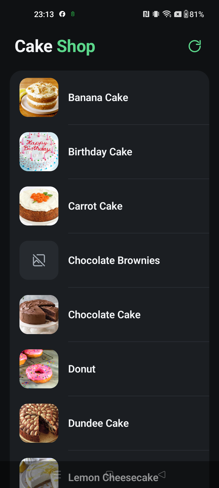
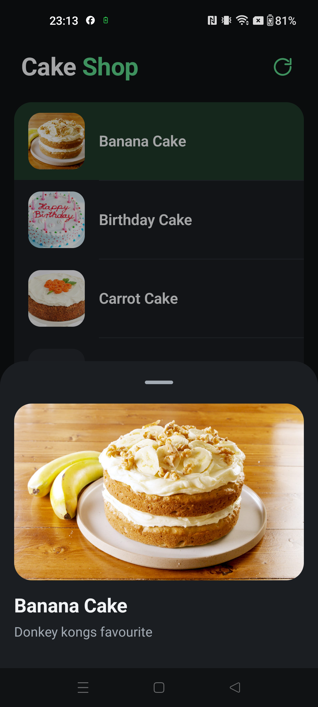
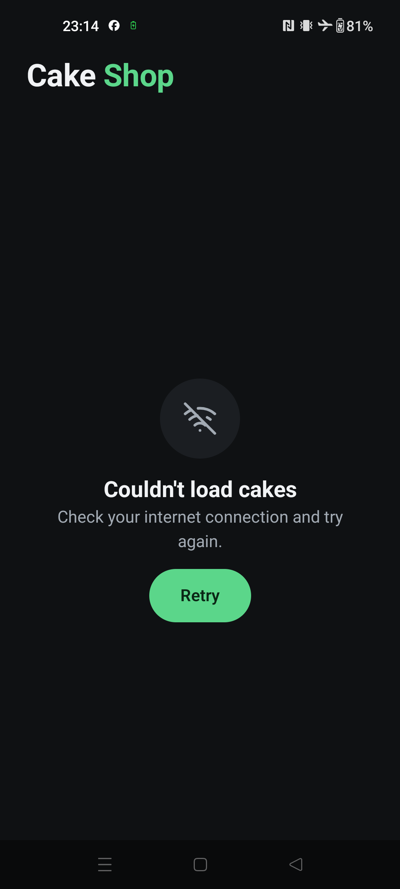
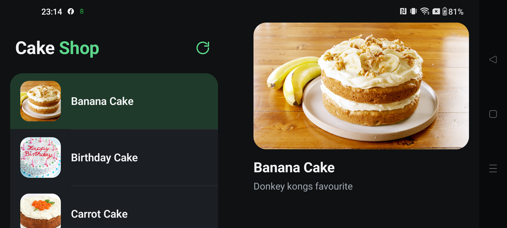

# Cake Shop

My solution to the Waracle Android exercise. The app loads cakes from the
[test API](https://raw.githubusercontent.com/Waracle/mobile-coding-test-api/refs/heads/main/cakes),
removes the duplicates, sorts them by title and shows a cake's description when you tap it.

| List | Details | Error | Landscape |
|---|---|---|---|
|  |  |  |  |

## Running it

Open the project in a recent stable Android Studio (it uses AGP 9.4) and run the `app` configuration on a
device or emulator with Android 10 (API 29) or newer.

Or from the command line:

```bash
./gradlew :app:assembleDebug
adb install -r app/build/outputs/apk/debug/app-debug.apk
```

## Tests

```bash
./gradlew test
```

The two cases the task asks for are in
[CakesViewModelTest](feature/cakes/presentation/src/test/java/com/koti/cake/feature/cakes/presentation/CakesViewModelTest.kt):
a successful load shows the cakes sorted and without duplicates, and a failed load shows the error.

There are also tests for the use case, the repository, the network error mapping and the Koin graph.
I used fakes rather than a mocking library. The shared test data and fakes live in Gradle test fixtures
(`TestCakes` and `FakeCakeRepository` in `feature:cakes:domain`, `FakeLogger` in `core:network`), so tests can
share them and they never end up in the app.

There are a few Compose UI tests for the list screen too (titles shown, Retry on error, tapping a cake).
These need a device or emulator:

```bash
./gradlew connectedDebugAndroidTest
```

Debug builds include [LeakCanary](https://square.github.io/leakcanary/). If it finds a leak, it shows up in the
"Leaks" app it adds to the launcher, and in Logcat under the `LeakCanary` tag.

## What it does

- Each row shows the cake's image and title, with a divider between rows
- Duplicates are removed and the list is sorted by title
- Tapping a cake opens its description in a bottom sheet. On wider windows, such as a phone in landscape,
  the description opens next to the list instead.
- Refresh from the top bar button or by pulling down
- If loading fails there is a full-screen error with a Retry button. If a refresh fails while cakes are already
  showing, you get a snackbar and the list stays.
- Rotating the device doesn't reload the list
- Rows fade in on the first load
- Light and dark themes

## How it's built

It's MVI on top of clean architecture layers, split into Gradle modules by feature:

| Module | What's in it |
|---|---|
| `app` | `MainActivity`, the `Application` class, Koin setup |
| `core:domain` | `AppResult` and `DataError`, used by every layer |
| `core:network` | `safeApiCall`, which turns exceptions into a `DataError` |
| `core:designsystem` | Theme, colours, list items, and the loading, empty and error states |
| `core:navigation` | Navigation 3 scene strategies for the bottom sheet and the list-detail layout |
| `feature:cakes:domain` | `Cake`, `CakeRepository` and `GetCakesUseCase` (dedupe and sort). Plain Kotlin, no Android. |
| `feature:cakes:data` | The Retrofit API, DTOs and the repository implementation |
| `feature:cakes:presentation` | `CakesViewModel`, the list screen, the details sheet and navigation |

Data goes one way: screen → `CakesViewModel` → `GetCakesUseCase` → `CakeRepository` → Retrofit.
The screen sends a `CakesAction` (Retry, Refresh or ErrorShown) to `onAction()`, and the ViewModel exposes a
single immutable `CakesUiState` as a `StateFlow`. I kept it simple: there's no separate reducer or effect
channel. One-off messages such as the refresh error live in the state, and an action clears them.

## Choices I made

- **Compose with Material 3**, as the standard choice for a new Android UI. The feature modules go through the
  design system and don't depend on Material directly.
- **Koin** for dependency injection. For an app this size it's lighter than Hilt and doesn't need code generation.
- **Retrofit with kotlinx.serialization** for the API, and **Coil** for images.
- **Navigation 3.** The details sheet and the side-by-side layout are both scene strategies. For the list-detail
  layout I used the official one from `adaptive-navigation3` rather than writing my own.
- **What counts as a duplicate.** Only cakes where the title, description and image are all the same. Two
  different cakes can have the same title, so I didn't dedupe on the title alone.
- **Errors are state.** They're kept in the UI state rather than sent as one-off events, so they survive rotation.

## With more time

These are also marked as `TODO`s in the code.

- Cache the cakes in Room, so the list works offline and shows straight away after process death
- Key the list items by an id, if the API ever adds one
- Move the shared Gradle setup into convention plugins
- Add a release signing config

## Use of AI

I used an AI assistant (Claude) for:

- Researching libraries and APIs, and reviewing the tests
- Code review
- Helping write the documentation, including this README
- A last check that the project covers everything in the task
- A full check of the app on a device before submitting, to make sure everything works
